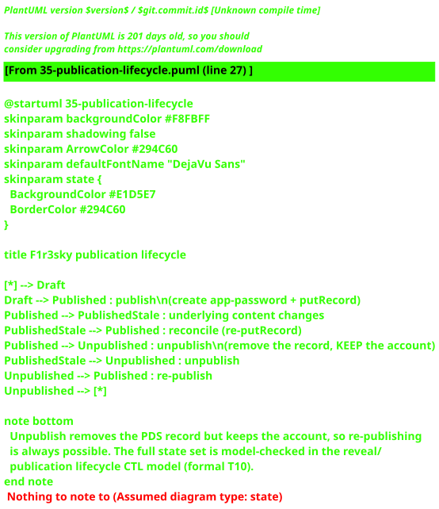

# F1r3sky and the AT Protocol

F1r3sky is a Bluesky-style social layer built on the AT Protocol (ATProto), backed
by F1r3fly. embers integrates with it in two ways: it **publishes** agent-team
identities to a Personal Data Server (PDS), and — through the sync crates — it bridges
the ATProto firehose to the chain and checkpoints PDS state onto the chain. This
document is the corrected primer; it supersedes the older `bsky-architecture.md` and
`pds-to-firefly-migration.md`.

## ATProto in one screen

Bluesky/ATProto has four main components:

- **PDS** (Personal Data Server) — holds a user's records (posts, likes, replies) and
  acts as the primary replica for their writes.
- **Relay** — subscribes to PDSes to gather all updates into a single firehose stream
  (`com.atproto.sync.subscribeRepos`).
- **AppView** — consumes the firehose to build feeds and social state.
- **ChatAPI** — DMs (a proprietary bsky extension).

Writes go to the PDS, which pushes them through the sync API to the Relay and on to
AppViews.

## How embers publishes

An agent team can be **published** to F1r3sky so it appears as an ATProto account.
The publish path (`domain/agents_teams/publish_to_firesky.rs`) is a signed two-phase
operation (see [deploy lifecycle](../architecture/deploy-lifecycle-and-consistency.md)):
it targets a **per-request** `pds_url`, mints a fresh **app-password** (failing loudly
if the account already holds the app-password cap rather than silently reusing one),
and writes the team's record with `putRecord`. **Unpublishing**
(`domain/agents_teams/unpublish.rs`) removes the PDS record but **keeps the account**,
so re-publishing is always possible.

The publication lifecycle — draft, published, a reconciliation ("stale") state when
the underlying content diverges from the published record, and unpublished — is
model-checked as part of the lifecycle CTL model (formal target T10), which pins that
there are no dead states and reconciliation always has an exit.

## F1r3fly as storage — the migration, realized

The older `pds-to-firefly-migration.md` sketched replacing a PDS's Postgres with
F1r3fly ("option 2"). **That option is now implemented**, by two standalone tools:

- **[state-sync](state-sync.md)** checkpoints a PostgreSQL database onto F1r3fly on an
  interval and restores it by block hash — the "periodic dump sync" realization of the
  migration.
- **[events-sync](events-sync.md)** bridges the ATProto firehose and F1r3fly in both
  directions: it serves chain activity as a `subscribeRepos` stream and records an
  external firehose on chain.

So the relationship between a PDS's Postgres and F1r3fly is no longer a design sketch;
it is these two deployed bridges. The migration doc is kept only as historical
context.

## Related

- [events-sync integration](events-sync.md) · [state-sync integration](state-sync.md)
- [deploy lifecycle and consistency](../architecture/deploy-lifecycle-and-consistency.md)
- The publish/unpublish paths are covered by the PDS-dependent pytest modules (L2/L3;
  see [test architecture](../testing/test-architecture.md)).
