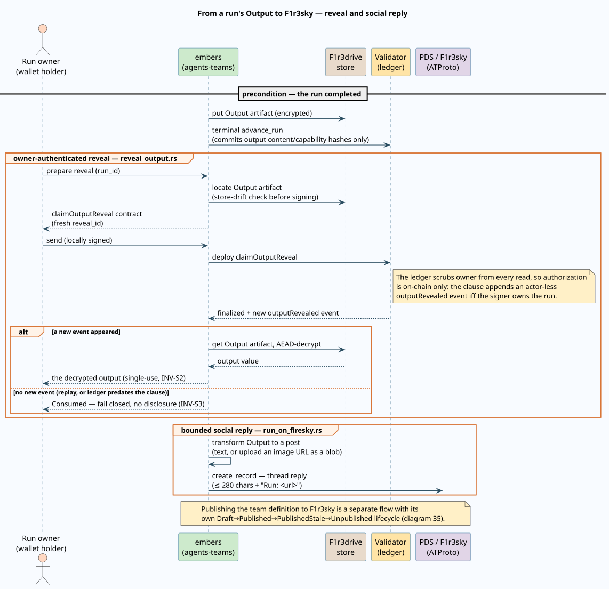

# F1r3sky and the AT Protocol

F1r3sky is a Bluesky-style social layer built on the AT Protocol (ATProto), backed
by F1r3fly. embers integrates with it in three ways: it **publishes** agent-team
identities to a Personal Data Server (PDS), **surfaces a run's output** back to
F1r3sky (owner reveal and bounded social replies), and — through the sync crates —
bridges the ATProto firehose to the chain and checkpoints PDS state onto the chain. This
document is the corrected primer; it supersedes the older `bsky-architecture.md` and
`pds-to-firefly-migration.md`.

## ATProto in one screen

Bluesky/ATProto has four main components:

- **PDS** (Personal Data Server) — holds a user's records (posts, likes, replies) and
  acts as the primary replica for their writes.
- **Relay** — subscribes to PDSes to gather all updates into a single firehose stream
  (`com.atproto.sync.subscribeRepos`).
- **AppView** — consumes the firehose to build feeds and social state.
- **ChatAPI** — DMs (a proprietary bsky extension).

Writes go to the PDS, which pushes them through the sync API to the Relay and on to
AppViews.

## How embers publishes

An agent team can be **published** to F1r3sky so it appears as an ATProto account.
The publish path (`domain/agents_teams/publish_to_firesky.rs`) is a signed two-phase
operation (see [deploy lifecycle](../architecture/deploy-lifecycle-and-consistency.md)):
it targets a **per-request** `pds_url`, mints a fresh **app-password** (failing loudly
if the account already holds the app-password cap rather than silently reusing one),
and writes the team's record with `putRecord`. **Unpublishing**
(`domain/agents_teams/unpublish.rs`) removes the PDS record but **keeps the account**,
so re-publishing is always possible.

The publication lifecycle — draft, published, a reconciliation ("stale") state when
the underlying content diverges from the published record, and unpublished — is
model-checked as part of the lifecycle CTL model (formal target T10), which pins that
there are no dead states and reconciliation always has an exit.

## From a run's Output to F1r3sky

When an Agent-Teams run completes, the kernel stores its final value as the encrypted
`Output` artifact and commits only its hashes on chain (see
[the durable kernel](../architecture/agent-team-kernel.md)). That output reaches
F1r3sky along two independent paths.

**Owner reveal** (`domain/agents_teams/reveal_output.rs`). The run's on-chain owner
reads the value back through the signed two-phase protocol: prepare renders a
`claimOutputReveal` contract, the client signs it locally, and the send deploys it.
Authorization is adjudicated **on chain** — the ledger scrubs `owner` from every read,
so the clause itself appends an actor-less `outputRevealed` event iff the signer owns
the run, and the backend releases the decrypted value only against that positive
acknowledgment. Reveal is **single-use** (a replayed envelope's identical deploy never
lands twice, so no new event appears; INV-S2) and **fail-closed** (no acknowledgment ⇒
no disclosure; INV-S3). Each prepare mints a fresh reveal id, so revealing again is
always one prepare away.

**Bounded social reply** (`domain/agents_teams/run_on_firesky.rs`). For a team
connected to F1r3sky, embers runs the team and posts its output as a thread reply: the
output value is transformed into a post (text, or an image URL uploaded as a blob),
then truncated to fit a terminal reply of at most 280 characters while always
preserving a `Run: <url>` link back to the run.

Publishing the **team** (above) is a separate flow with its own
Draft→Published→PublishedStale→Unpublished lifecycle; revealing or replying with a
**run's output** does not change the team's publication state.

## F1r3fly as storage — the migration, realized

The older `pds-to-firefly-migration.md` sketched replacing a PDS's Postgres with
F1r3fly ("option 2"). **That option is now implemented**, by two standalone tools:

- **[state-sync](state-sync.md)** checkpoints a PostgreSQL database onto F1r3fly on an
  interval and restores it by block hash — the "periodic dump sync" realization of the
  migration.
- **[events-sync](events-sync.md)** bridges the ATProto firehose and F1r3fly in both
  directions: it serves chain activity as a `subscribeRepos` stream and records an
  external firehose on chain.

So the relationship between a PDS's Postgres and F1r3fly is no longer a design sketch;
it is these two deployed bridges. The migration doc is kept only as historical
context.

## Relationship to the channel-connector layer

F1r3sky was the first external interface, and the grant-based channel-connector
layer ([F1R3BotGateway chat](f1r3botgateway.md), [F1R3Mail](f1r3mail.md))
**generalizes its pattern**: the mention-triggered run signed by the user's own
wallet becomes a run under a standing, revocable on-chain grant, so channels
whose service can never hold the user's key still start user-owned runs. This
integration still runs its bespoke adapter (`run_on_firesky.rs`); migrating it
onto the connector layer is a documented follow-on
([ADR-004](../../../embers-frontend/docs/architecture/decisions/004-grant-based-channel-connectors.md)),
not part of the connector change.

## Related

- [events-sync integration](events-sync.md) · [state-sync integration](state-sync.md)
- [F1R3BotGateway integration](f1r3botgateway.md) · [F1R3Mail integration](f1r3mail.md)
- [deploy lifecycle and consistency](../architecture/deploy-lifecycle-and-consistency.md)
- The publish/unpublish paths are covered by the PDS-dependent pytest modules (L2/L3;
  see [test architecture](../testing/test-architecture.md)).
