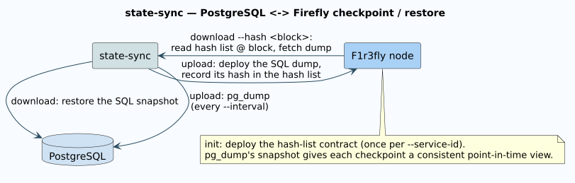

# state-sync integration

`state-sync` checkpoints a PostgreSQL database onto F1r3fly and restores it — a way
to keep a Postgres-backed service's state durable on chain. This document covers the
checkpoint cycle and the on-chain contract; the CLI surface is in the
[crate README](../../packages/state-sync/README.md).

Implementation: `packages/state-sync/`. Like `events-sync`, it is configured by CLI
flags — the globals `--wallet-key`, `--deploy-service-url`, `--service-id` identify
the signer, the target validator, and this service's on-chain channels.

## `init` — the hash-list contract

`state-sync init` deploys this service's on-chain contract — the **hash-list
channel** that `upload` appends to and `download` reads from. Run once per
`--service-id`.

## `upload` — periodic checkpoint

`state-sync upload --db-url … --interval N` loops on a fixed cadence: every `N`
seconds it runs `pg_dump` against `--db-url`, deploys the resulting SQL dump to
F1r3fly under a fresh channel, and records the dump's hash under this service's
hash-list channel. `pg_dump`'s own snapshot semantics give each checkpoint a
**consistent point-in-time** view of the database, so a restored snapshot is never a
torn read. The Docker `state-sync` profile runs this with a 300 s interval by
default.

## `download` — restore

`state-sync download --hash <block>` restores a snapshot: it reads this service's
hash list at the given block hash and fetches the corresponding dump, which can then
be loaded back into Postgres. Addressing by block hash makes restores reproducible —
the same `<block>` always yields the same snapshot.

## Notes

- This is the **only** PostgreSQL touchpoint in the workspace. embers itself uses no
  database — its state is on chain or in the F1r3drive
  [continuation store](../architecture/continuation-store.md).
- state-sync is a standalone tool deployed via the Docker `state-sync` compose
  profile (see the [Docker guide](../operations/docker.md)); it shares no state with
  the embers binary.
- It is the realized form of the "periodic dump sync" option from the historical
  PDS-to-Firefly migration sketch.
