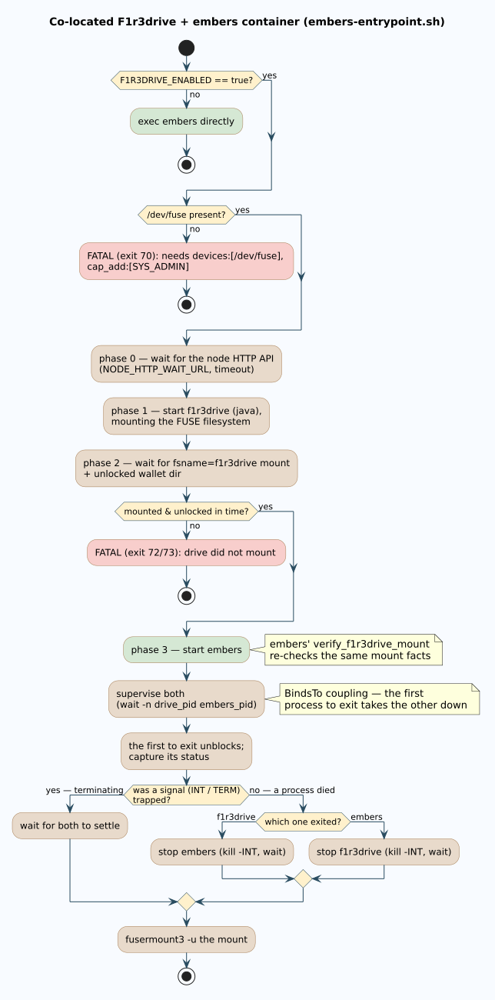

# Docker

embers ships as Docker images and two compose files. This guide covers the images,
the co-located F1r3drive supervisor that lets embers satisfy its FUSE mount
requirement inside a container, the compose topologies and profiles, and how secrets
are supplied.

Files: `docker/embers.dockerfile`, `docker/events-sync.dockerfile`,
`docker/state-sync.dockerfile`, `docker/embers-entrypoint.sh`,
`docker/docker-compose.yaml`, `docker/docker-compose-staging.yaml`.

## Images

| Image | Dockerfile | Contains |
| ----- | ---------- | -------- |
| embers | `embers.dockerfile` | The embers binary, the F1r3drive JAR, and `embers-entrypoint.sh` (the supervisor). |
| events-sync | `events-sync.dockerfile` | The [events-sync](../../packages/events-sync/README.md) CLI. |
| state-sync | `state-sync.dockerfile` | The [state-sync](../../packages/state-sync/README.md) CLI. |

## The co-located F1r3drive supervisor

embers refuses to boot unless its continuation store is inside a `fsname=f1r3drive`
FUSE mount (see [F1r3drive integration](../integrations/f1r3drive.md)). Compose
cannot order a mount across projects, and the mount must be visible in the *same*
mount namespace as embers — so the embers image runs **both** F1r3drive and embers
in one container, sequenced by `embers-entrypoint.sh`:



```text
supervise():
    if F1R3DRIVE_ENABLED != true:  exec embers            # drive disabled: run embers alone
    require /dev/fuse                                       # else FATAL (exit 70)
    phase 0:  wait for the node HTTP API (NODE_HTTP_WAIT_URL)   # cross-project ordering
    phase 1:  start f1r3drive (java -jar), which mounts FUSE
    phase 2:  wait until /proc/mounts shows "f1r3drive <mount> fuse"
              AND the unlocked wallet dir <mount>/<wallet> exists   # else FATAL (72/73)
    phase 3:  start embers                                  # its verify_f1r3drive_mount re-checks the same facts
    wait -n drive embers                                    # whichever exits first...
    take the other down; fusermount3 -u <mount>            # ...BindsTo coupling
```

Because of this, the embers service **must** be granted FUSE access:

```yaml
devices:      [ /dev/fuse ]
cap_add:      [ SYS_ADMIN ]
security_opt: [ apparmor:unconfined ]   # on AppArmor hosts
```

and the F1r3drive cipher-key file must live on a **persistent volume** — losing it
makes previously written drive content undecryptable. The entrypoint variables
(`F1R3DRIVE_VALIDATOR_HOST/PORT`, `F1R3DRIVE_OBSERVER_HOST/PORT`, `F1R3DRIVE_MOUNT`,
`F1R3DRIVE_KEY_FILE`, `F1R3DRIVE_JAR`, `F1R3DRIVE_WALLET_ADDRESS`,
`F1R3DRIVE_WALLET_KEY`, `NODE_HTTP_WAIT_URL`, …) are documented inline in
`embers-entrypoint.sh`; the continuation-store `MOUNT_PATH` must be a path **inside**
`F1R3DRIVE_MOUNT/<wallet>`.

## Compose files

- **`docker-compose.yaml`** — the F1r3fly nodes (`firefly`, `firefly-read`, and the
  testnet pair) plus the sync services, driven by profiles:
  - **`state-sync`** profile: `state-sync-init` then a long-running `state-sync
    upload` against the local Postgres and node (see [state-sync](../integrations/state-sync.md)).
  - **`multiple-networks`** profile: `events-init`, `events-listen`, `events-push`
    wiring the ATProto firehose bridge (see [events-sync](../integrations/events-sync.md)).
- **`docker-compose-staging.yaml`** — a full app deployment: the four F1r3fly node
  services, `embers` (with the co-located F1r3drive), `embers-frontend`, and an
  `nginx` TLS proxy on `:443`. embers `depends_on` all four nodes' health checks.

## Secrets

No secret value is committed. The staging compose loads secrets from an **untracked**
`docker/embers-staging.secrets.env` (copy the committed
`docker/embers-staging.secrets.env.example` and fill it in); the real file is
`.gitignore`d. Non-secret topology (node URLs, address/port, F1r3drive hosts, mount
root) stays inline. See [key inventory](../security/key-inventory.md) for what each
secret protects and its rotation semantics, including the finding that earlier
revisions of the staging compose embedded real keys.

## Relationship to the native dev-net

The Docker path and the native [local stack](local-stack.md) satisfy the same
contracts (a healthy node, a `fsname=f1r3drive` FUSE mount, the `EMBERS__…`
configuration). Docker co-locates F1r3drive and embers in one container; the native
stack runs them as separate systemd `--user` units in the caller's mount namespace.
