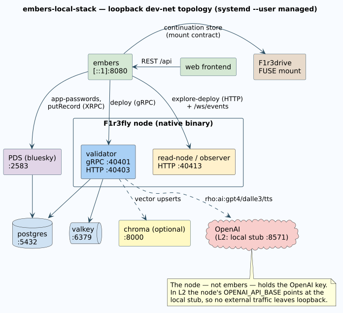

# Local dev-net (L2 substrate)

The **L2** test layer runs the backend against a complete **loopback** F1r3fly dev-net
(see [test architecture](../testing/test-architecture.md)). This document describes
that dev-net as a **contract** — the services embers needs and the loopback endpoints
it expects — not a specific launcher. Bringing the services up is done by a **local
launcher external to this repository** (the maintainer runs one locally; any
equivalent — a script, Docker, or hand-run processes — works as long as it satisfies
the contract). embers is not coupled to any particular launcher; it only needs the
endpoints below and a F1r3drive mount.

## What the dev-net must provide



| Service | Endpoint (loopback) | Why embers needs it |
| ------- | ------------------- | ------------------- |
| Validator node | gRPC `:40401`, HTTP `:40403` | Submit deploys; read the head block; WS finality events. |
| Read-node / observer | HTTP `:40413` | `explore-deploy` reads. |
| F1r3drive | a `fsname=f1r3drive` FUSE mount | The continuation store must live on it, or embers refuses to boot ([F1r3drive integration](../integrations/f1r3drive.md)). |
| PDS | `:2583` | F1r3sky publish/unpublish/reveal paths (the `pds`-marked tests). |
| Postgres / valkey | `:5432` / `:6379` | Backing services the node/PDS use. |
| Chroma (optional) | `:8000` | The research-desk RAG demo (the `chroma`-marked tests). |

The native node is a `f1r3node` build; embers is built from this repository with the
`gxhash` target features (`RUSTFLAGS="-C target-feature=+aes,+sse2"`, already set in
`.cargo/config.toml`). embers binds `[::1]:8080` by default (`EMBERS_API_URL`).

## The OpenAI stub (hermetic model calls)

The one L2 piece embers *does* own is the local OpenAI stub, so model calls stay on
loopback (the machine can't run GPT-4). The **node**, not embers, calls OpenAI, so
point the node's `OPENAI_API_BASE` at the stub:

```sh
cargo make l2-stub          # build + start the stub on 127.0.0.1:8571 (user unit)
# then set, in your launcher's node environment:
#   OPENAI_API_BASE=http://127.0.0.1:8571/v1
```

`openai-api-rs` (which the node uses) reads `OPENAI_API_BASE` in `build()`, so no node
patch is needed. The node's startup validation calls `GET /v1/models`, which the stub
serves; confirm uptake with `curl 127.0.0.1:8571/stub/requests`. See the
[OpenAI stub](../../packages/openai-stub/) crate.

## Running the L2 suite

Once the dev-net is up and the node points at the stub:

```sh
cargo make l2-test          # pytest -m "devnet and not remote" against $EMBERS_API_URL
cargo make l2-recovery      # the durable-recovery suite (needs EMBERS_SERVICE_UNIT)
cargo make l2-stub-stop     # stop the stub when done
```

`pds`/`chroma`/`gpt`/`recovery`-marked tests skip automatically when their backing
service is absent (the session-cached probes in `conftest.py`), so a partial dev-net
runs exactly the subset it supports. See [CI and tooling](ci-and-tooling.md).

## Relationship to Docker

The [Docker path](docker.md) satisfies the same contract (a healthy node, a
`fsname=f1r3drive` mount, the `EMBERS__…` configuration) by co-locating F1r3drive with
embers in one container — an alternative to a native local launcher.
