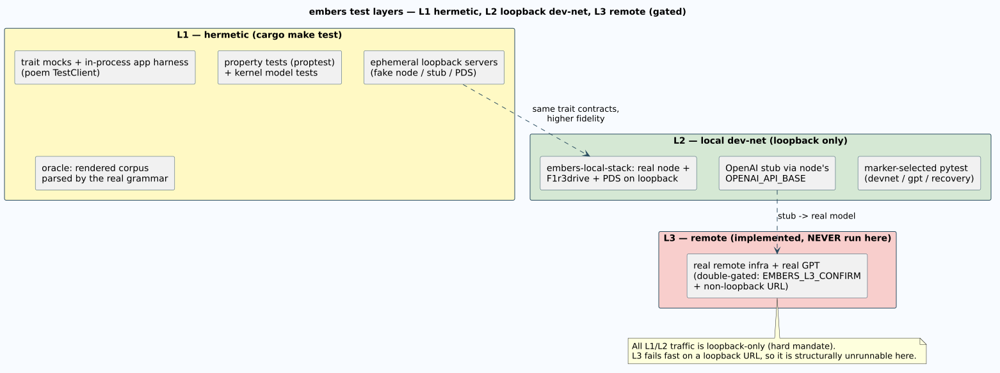

# Test architecture

embers is tested in three layers, so that the everyday suite is fully hermetic while
higher-fidelity checks against a real dev-net remain one command away and remote
checks stay gated off. **All L1 and L2 traffic is loopback-only** — a hard project
mandate; nothing reaches an external host.

## The three layers

| Layer | What runs | Where | Command |
| ----- | --------- | ----- | ------- |
| **L1 — hermetic** | Every external (node, OpenAI, PDS) is stubbed on loopback or mocked in-process. | Here, in CI | `cargo make test` |
| **L2 — local dev-net** | A real F1r3fly node + F1r3drive + PDS on loopback, with the LLM stubbed locally. | Here, on demand | the L2 orchestration over [local stack](../operations/local-stack.md) |
| **L3 — remote** | Real remote infrastructure and real GPT. Implemented but **double-gated** (requires `EMBERS_L3_CONFIRM=1` and a non-loopback URL), so it is structurally unrunnable here. | Never here | (gated) |

## What makes L1 possible: the trait seams

Every f1r3node interaction goes through one of three traits — `ReadNode`,
`WriteNode`, `NodeEventSource` (see [crate architecture](../architecture/crate-architecture.md)).
Every embers domain service and API struct is generic over that triple with the real
clients as defaults, so the whole backend can be driven against **mocks in-process**:

- **Trait mocks** (`packages/embers/src/domain/test_helpers.rs`): a `MockReadNode`
  with substring-matched canned JSON and empty-before/values-before lag simulation, a
  `MockWriteNode`, and a `MockNodeEventSource`. `NodeEvents` also offers a
  `#[cfg(test)] new_for_test` that injects a broadcast channel while reusing the
  production dispatch loop.
- **The in-process app harness** (campaign step A4): `build_app` assembles the real
  OpenAPI routes over the mock triple, and `poem::test::TestClient` drives full
  prepare→sign→send flows with assertions on the deployed bytes — no sockets, no node.
- The continuation store's `#[cfg(test)] open_for_test` bypasses the F1r3drive mount
  check (see [F1r3drive integration](../integrations/f1r3drive.md)), so store-backed
  tests run on ordinary temp storage.

## Property-based testing

Alongside example tests, the suite is property-based (proptest):

- **Leaf-crate properties** (campaign step A2): base58check/zbase32 codec round-trips
  and corruption detection, secp256k1 signing verify + determinism, the Rholang
  string escaper's round-trip and injectivity (the injection-safety property — see
  [Rholang templating](../design/rholang-templating.md)), and the retry budget.
- **Kernel model-based tests** (campaign step A5): shrink-friendly workflow/command
  generators feeding executable invariants that mirror the formal
  [invariant registry](../formal/INVARIANTS.md) — token conservation, bounded-cycle
  termination, join/quorum/race semantics, deterministic replay. The generators
  target exactly the registry's invariant IDs, so the property tests and the formal
  models check the same statements.

## The parser oracle

`cargo make oracle-test` renders every `Render` template with fixture data and parses
the output under the **real Rholang grammar** (the detached `oracle/` crate wrapping
rholang-rs; campaign step A9). A template that renders syntactically invalid Rholang
fails a test rather than a live deploy. This is the end-to-end check behind the
[templating](../design/rholang-templating.md) escaping guarantees.

## The loopback doubles

Higher-fidelity L1 and all of L2 run against loopback test doubles that speak the
same wire contracts as the real services:

- **Fake node** (`packages/firefly-test-node`): an in-process fake validator +
  observer + event stream on `127.0.0.1:0` — the gRPC deploy service, the
  explore-deploy HTTP envelope (with scriptable empty→populated lag), and injectable
  finality events — so `firefly-client` itself is tested against a real socket.
- **OpenAI stub**: a loopback server the **node** points at via `OPENAI_API_BASE`
  (embers never calls OpenAI; the node's `rho:ai:*` channels do), so even the model
  calls stay on loopback and the machine needs no real GPT-4. See
  [local stack](../operations/local-stack.md).
- **Fake PDS**: a loopback ATProto server for the F1r3sky publish paths.

The precise **fidelity ledger** — exactly what each double mirrors and where it
diverges from a real service — is in [test doubles](test-doubles.md).

## The Python suite

`packages/embers/tests/` is marker-layered (campaign step A1): `addopts` excludes
`remote` by default; markers (`devnet`, `pds`, `chroma`, `gpt`, `remote`, `recovery`,
`slow`) plus session-cached service probes skip cases whose backing service is not up,
and the L3 guard fails unless both `EMBERS_L3_CONFIRM=1` and a non-loopback
`EMBERS_API_URL` are set. See [CI and tooling](../operations/ci-and-tooling.md).
